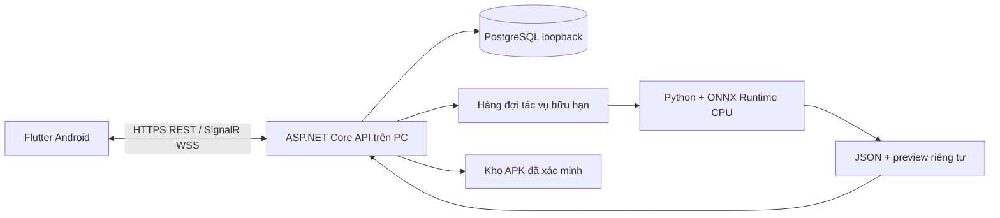

# Kiến trúc FruitVision client–server

## Ranh giới và công nghệ

Tunnel đưa duy nhất API loopback ra HTTPS/WSS. Điện thoại không truy cập DB, Python hoặc thư mục lưu trữ trực tiếp. API và nghiệp vụ backend cùng tiến trình .NET: endpoint/middleware kiểm schema, kích thước, phiên và quyền trước khi gọi nghiệp vụ/DB/worker; không phải hai server kiểm tra trùng nhau.

## Tài khoản và tương tác

Identity kiểm password hash, lockout và TOTP nếu bật. Server cấp phiên opaque, xoay refresh token; client giữ phiên qua Android Keystore AES-GCM. TOTP là mã xác thực, không phải vân tay; chưa có luồng sinh trắc học.

API kiểm Approved/Admin/Seller và quyền sở hữu mỗi yêu cầu. Duyệt tin có reason/audit/revision và giao dịch chống hai quyết định cùng thắng. Liên hệ từ bài tạo đúng hội thoại hai người; yêu cầu lặp/đồng thời trả cùng ID. Tin nhắn lưu DB/outbox; dispatcher đọc thành viên hiện tại, không dựa vào hub membership cũ. Client dùng REST phục hồi lịch sử sau reconnect.

Nhóm có giới hạn thành viên/chủ nhóm; đóng chặn gửi mới nhưng giữ lịch sử cho thành viên. Tổng hợp vùng chỉ lấy bài Published của tác giả hoạt động đã duyệt, tách cung/cầu và giá chào bán; không biến dự kiến thành tồn kho hoặc dự đoán giá.

## AI trên PC

1. Client stream JPEG/PNG hoặc MP4 lên API với request ID.
2. API kiểm quyền, định dạng/kích thước/quota; tạo tác vụ Queued trong DB.
3. Worker .NET nhận việc và chạy Python trong môi trường riêng; Python decode, suy luận ONNX, hậu xử lý/tracking.
4. Server ghi trạng thái/kết quả, gửi SignalR; client GET JSON/JPEG với kiểm chủ sở hữu.

Một worker xử lý tuần tự, tối đa bốn tác vụ hoạt động toàn hệ thống và một mỗi người. Gốc được xóa sau kết thúc; preview/kết quả hiện chưa có lịch hết hạn tự động. Xem [AI API](../server/docs/AI_API_USAGE.md). Python không có endpoint public hoặc quyền tự nhận việc từ điện thoại.

**ONNX** biểu diễn đồ thị/trọng số; **ONNX Runtime** thực thi đồ thị. **FP32** dùng số thực 32 bit. Bản này giữ YOLOX-Tiny FP32 trên PC; không dùng FPS native offline để quảng cáo tốc độ client-server, không tuyên bố chưng cất/INT8/GPU trong đợt này.

## Cập nhật và vận hành

Client kiểm versionCode/ABI. Server chỉ phục vụ APK đã đăng ký bất biến; native tải có giới hạn, cấm redirect/host khác, kiểm SHA/kích thước/package/version/signer trước khi mở trình cài Android. Người dùng vẫn xác nhận. Xem [quy trình phát hành](../server/docs/MOBILE_RELEASES.md).

PC/API/DB/worker/tunnel phải hoạt động. Tunnel tạm không cam kết hostname/uptime cố định. Domain cố định, diễn tập backup/restore, secret manager, release signer riêng, nhiều worker và giám sát production là các bước sau; không ghi chúng là đã triển khai. Hạn chế đếm/nhãn nguồn và điều kiện phi thương mại vẫn áp dụng.
