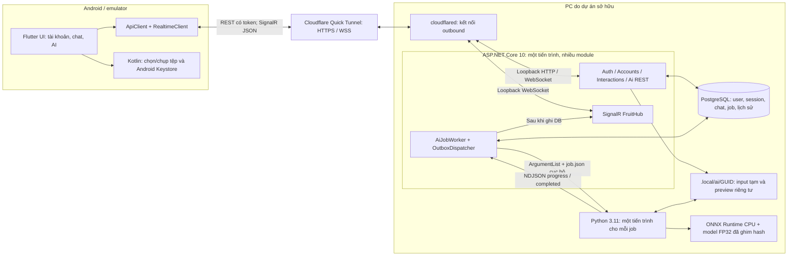

> Lưu trữ bằng chứng 2.0–2.1; các biên nhận local không nằm trong Git. Bản hiện tại xem [demo 2.2](DEMO_4_ROLES_2_2.md) và biên nhận cùng APK, không coi thông tin dưới đây là trạng thái mới nhất.

# FruitVision 2.1 — Kiến trúc và luồng kỹ thuật để trình bày demo

Đối chiếu mã và biên nhận ngày 30/10/2026. FruitVision 2.1 là ứng dụng Flutter gọi một backend ASP.NET Core chạy trên PC. Backend giữ quyền quyết định tài khoản, dữ liệu và tác vụ; PostgreSQL giữ trạng thái bền vững; tiến trình Python riêng chạy model ONNX trên CPU. Điện thoại chọn/chụp tệp, truyền bytes và hiển thị kết quả từ máy chủ.

Lát cắt hiện có: tài khoản/xét duyệt, tin dự kiến, chat, lịch sử và AI ảnh/video hữu hạn. **Chụp ảnh mở ứng dụng máy ảnh bên ngoài để nhận một JPEG**; chưa triển khai truyền camera liên tục hoặc suy luận live camera stream. APK mới không chứa model/runtime AI; mã offline lịch sử ở `app/` được giữ riêng. Xem [hướng dẫn API](AI_API_USAGE.md) và [hợp đồng worker](../ai/README.md).

## 1. Ranh giới hệ thống



TLS bảo vệ đoạn mạng công khai HTTPS/WSS; kết nối từ agent tunnel đến Kestrel là loopback trên PC. PostgreSQL chỉ nghe loopback; Python không mở cổng. Điện thoại không nhận chuỗi kết nối DB, đường dẫn model hoặc quyền đọc cả thư mục upload. API chỉ tin forwarded headers từ proxy loopback đã cấu hình, không tin mọi proxy trên Internet. Cấu hình và điểm ghép module nằm ở [Program.cs](../src/FruitVision.Api/Program.cs).

| Thành phần | Vai trò cụ thể trong bản 2.1 |
|---|---|
| Flutter/Dart | Giao diện, state màn hình, HTTP, WSS, xử lý mất mạng và vòng đời app |
| Kotlin qua MethodChannel | Android Keystore, chọn/chụp ảnh, sao chép media vào cache riêng có giới hạn |
| ASP.NET Core / Identity | Contract, phiên đăng nhập, TOTP, policy, quyền sở hữu và API |
| EF Core / Npgsql / PostgreSQL | Ghi/đọc có transaction, ràng buộc duy nhất, migration và job bền vững |
| BackgroundService | Đọc hàng đợi DB; quản lý tiến trình/timeout/hủy; phát sự kiện sau khi ghi |
| CPython / Pillow / OpenCV / ONNX Runtime | Decode, tiền xử lý, suy luận, tracking và preview |

Đây là **backend nguyên khối có module, kết hợp worker tiến trình con**, không phải mỗi chức năng một microservice. Một PC, một API instance và một bộ xử lý AI đủ cho demo đã giới hạn tải: ít thành phần phải triển khai, transaction tài khoản/chat/job vẫn tập trung, lỗi decode có ranh giới tiến trình riêng. Không cần thêm message broker hay nhiều worker khi chưa đo được nhu cầu và nút thắt. Thiết kế hiện tại cũng không phải bằng chứng đã sẵn sàng chạy nhiều API instance.

## 2. Đăng nhập, hồ sơ và đúng bốn vai trò

1. Đăng ký chỉ nhận `Producer`, `Trader`, `Consumer`; máy chủ đặt hồ sơ `Pending`. Không có đăng ký Admin công khai và không nhận `approvalStatus` do client tự gán.
2. Đăng nhập kiểm mật khẩu và trạng thái tài khoản. Identity dùng PBKDF2; tài khoản đã bật MFA nhận challenge ngắn hạn và phải hoàn tất TOTP trước khi nhận token phiên.
3. API phát access/refresh token **opaque ngẫu nhiên 256 bit**, không phải JWT. DB giữ hash SHA-256 của token ngẫu nhiên; mật khẩu dùng cơ chế hash riêng của Identity. Access khoảng 15 phút, refresh tối đa 7 ngày.
4. Admin xét duyệt với lý do: `Approved`, `NeedsInformation` hoặc `Rejected`. Người dùng có thể gửi lại hồ sơ phù hợp để trở về `Pending`.
5. Mỗi request xác thực đọc session và user từ DB, rồi áp policy theo role và trạng thái. Ẩn tab ở Flutter chỉ hỗ trợ trải nghiệm; server mới quyết định cho phép.

| Vai trò | Quyền cần giải thích khi demo |
|---|---|
| Admin | Xét duyệt/khóa tài khoản, audit/thống kê; dùng AI khi hồ sơ Approved; không có quyền mặc định xem AI riêng tư của người khác |
| Producer | Xem công khai; khi Approved được gửi tin dự kiến, vào hội thoại có thành viên và dùng AI |
| Trader | Cùng policy gửi tin dự kiến như Producer sau duyệt; hội thoại có thành viên và AI |
| Consumer | Xem công khai; khi Approved dùng hội thoại có thành viên và AI; không có quyền đăng tin người bán |

User Pending vẫn đăng nhập, xem hồ sơ mình và nội dung công khai. Hub yêu cầu Approved, nên **Pending không nhận WSS để tự biết vừa được duyệt**; phải cập nhật hồ sơ qua REST. Khi nhận hồ sơ Approved, app mới mở kết nối cập nhật trực tiếp. Duyệt hồ sơ không phải chứng nhận chất lượng hay an toàn thực phẩm.

Nguồn: [AuthEndpoints.cs](../src/FruitVision.Api/Auth/AuthEndpoints.cs), [SessionTokens.cs](../src/FruitVision.Api/Auth/SessionTokens.cs), [AccountEndpoints.cs](../src/FruitVision.Api/Features/AccountEndpoints.cs), [models.dart](../../mobile_client/lib/client/models.dart), [session.dart](../../mobile_client/lib/client/session.dart).

## 3. Luồng ảnh/video từ chọn tệp đến kết quả

```mermaid
sequenceDiagram
  autonumber
  participant U as Người dùng / Flutter
  participant A as API trên PC
  participant D as PostgreSQL
  participant W as AiJobWorker
  participant P as Python + ORT CPU
  participant H as SignalR
  U->>A: POST /ai/jobs?mediaType=image|video, token, request ID, raw bytes
  A->>D: Xác thực session, user active + Approved; quota và request ID
  Note over A,D: Stream xuống thư mục GUID riêng; kiểm MIME, magic, giới hạn; tính SHA-256
  A->>D: Commit Queued, revision=1
  A->>H: AiJobChanged sau commit
  A-->>U: 202 + snapshot + Location
  W->>D: Đọc Queued; kiểm lại quyền; chuyển Running, revision tăng
  W->>P: Chạy python bằng ArgumentList và job.json tuyệt đối
  Note over P: Decode + resize/letterbox + ONNX + hậu xử lý; video suy luận từng khung
  loop Tiến độ có giới hạn
    P-->>W: NDJSON progress 0..99, framesProcessed
    W->>D: Ghi progress và revision mới
    W->>H: AiJobChanged
    H-->>U: Event riêng của user; bỏ qua revision cũ
  end
  alt Chủ sở hữu yêu cầu hủy
    U->>A: POST /ai/jobs/id/cancel
    A->>D: Commit Cancelled và lịch sử
    A->>W: CancellationToken của đúng job
    W->>P: Dừng đúng tiến trình con được sở hữu
  else Python hoàn tất
    P-->>W: completed + result + preview.jpg
    W->>D: Đọc lại trạng thái/quyền; chỉ ghi Succeeded nếu còn hợp lệ
    W->>D: Commit kết quả, progress=100, lịch sử, revision mới
    W->>H: AiJobChanged sau commit
  end
  Note over W,P: Xóa input gốc sau kết thúc; giữ metadata/result/preview riêng tư
  H-->>U: Thông báo trạng thái cuối có thể đến trước hoặc sau phản hồi HTTP
  U->>A: GET /ai/jobs/id và /preview bằng token
  A->>D: Kiểm chủ sở hữu từ user trong session
  A-->>U: JSON kết quả / JPEG có kiểm quyền
```

### Giao diện APK polished thể hiện luồng này thế nào?

- **Chọn/gửi:** ảnh và video có lựa chọn riêng; tác vụ gần đây có loại tệp, thời gian và tiến độ thật. Tệp đang chọn có thanh hành động cố định trên điều hướng, tách upload khỏi giai đoạn worker xử lý.
- **Xem kết quả:** ảnh JPEG chú thích xuất hiện trước và có phóng to; các ô số tách max thấy đồng thời, track xác nhận, lượt qua vạch. Thanh tỷ lệ chỉ dùng `gradeCounts`; video ghi rõ mẫu số track xác nhận. Không cộng các ô hoặc suy ra kg.
- **Giải thích:** modelName/SHA/schema/thời gian nằm trong mục Thông tin kỹ thuật; định nghĩa phép đếm, Chưa xác định và giới hạn nguồn nằm trong Cách hiểu kết quả. Đây là tổ chức lại dữ liệu API hiện có, không thêm model, lớp AI trên điện thoại hay bằng chứng độ chính xác mới.
- **Nghiệp vụ:** header hồ sơ/kết nối thu gọn, feed có biểu tượng nông sản và số kg dự kiến, nội dung dài mở bằng Đọc tiếp. Quyền của bốn vai trò vẫn do API kiểm tra.

Nguồn UI: [ai.dart](../../mobile_client/lib/client/ui/ai.dart), [visuals.dart](../../mobile_client/lib/client/ui/visuals.dart), [workspace.dart](../../mobile_client/lib/client/ui/workspace.dart). Test widget kiểm màn hình 320 px/cỡ chữ 1,4 và vị trí nút gửi trên điều hướng; nghiệm thu native ảnh/video/chat trên APK polished cuối hiện **đang chờ** biên bản riêng.

### Vì sao gửi stream thay base64?

Android đọc media do người dùng chọn vào cache riêng; Dart gửi `File.openRead()` vào HTTP stream. Backend dùng buffer 64 KiB để kiểm, tính hash và ghi tệp; không giữ toàn bộ video trong RAM. Base64 tăng kích thước khoảng một phần ba trước overhead JSON, đồng thời cần tạo chuỗi lớn và decode lại; cách đó không phù hợp body JSON giới hạn 32 KiB. Preview và phản hồi JSON nhỏ hơn vẫn có buffer nhận **có giới hạn**, không tuyên bố mọi bước đều zero-copy. Nguồn: [api.dart](../../mobile_client/lib/client/api.dart), [AiStorage.cs](../src/FruitVision.Api/Ai/AiStorage.cs), [MainActivity.kt](../../mobile_client/android/app/src/main/kotlin/vn/mangodemo/mango_offline/MainActivity.kt).

### Giới hạn tải và cơ chế tạo áp lực ngược

| Biên | Giới hạn đang có |
|---|---|
| Ảnh | JPEG/PNG thật, 12 MiB, tối đa 24 triệu pixel |
| Video | MP4 thật, 80 MiB, tối đa 120 giây, 3.600 khung, 1920×1080; chấp nhận chiều dọc |
| Decode video | FPS hợp lệ tới 240; timestamp phải tăng; kiểm metadata và kích thước frame thực |
| Thời gian | Upload 90 giây; worker 165 giây; tiến trình do API quản lý 180 giây |
| Hàng đợi | Một job Queued/Running mỗi user; tối đa bốn job hoạt động toàn hệ thống; một bộ xử lý |
| Preview | JPEG cố định trong thư mục job, tối đa 10 MiB, không Range, chỉ owner |

API từ chối `429` + `Retry-After` khi bận thay vì tích lũy công việc không giới hạn. Admission upload được tuần tự hóa; transaction/advisory lock và unique index bảo vệ quota/request ID. Video dưới giới hạn tệp vẫn có thể quá thời gian CPU: khi đó phải cắt ngắn, không trả kết quả một phần rồi gọi là hoàn tất.

`GET /ai/capabilities` lấy aiReady từ cấu hình và sự hiện diện của Python, worker, model/gói cần thiết; không chạy thử model nặng trên mỗi request. Khi chưa sẵn sàng, tạo job trả `503`. Readiness không phải chứng nhận accuracy: tác vụ thật và biên nhận riêng mới chứng minh đã chạy. [AiOptions.cs](../src/FruitVision.Api/Ai/AiOptions.cs).

Retry dùng cùng `X-Client-Request-Id` chỉ trả lại job gốc khi media, Content-Type, số byte và SHA-256 đều khớp; body retry cũng được stream/hash và kiểm giới hạn. Khác nội dung trả `409`. Hash còn trong DB sau khi raw input đã xóa; không cần giữ lại video để chống nhầm kết quả. [AiEndpoints.cs](../src/FruitVision.Api/Ai/AiEndpoints.cs), [AiJob.cs](../src/FruitVision.Api/Ai/AiJob.cs), [biên nhận retry HTTPS](ai-retry-https.json).

### Bền vững, hủy và quyền sở hữu

DB giữ `Queued`, `Running`, `Succeeded`, `Failed`, `Cancelled`, progress, revision, thời gian và kết quả JSON. Khi worker được bật lại sau restart, job Queued còn được đọc; Running mồ côi thành Failed, không tự suy luận lặp vô hạn. Nếu lỗi DB làm gián đoạn lưu trạng thái cuối, worker thử hoàn tất ghi Failed khi DB trở lại, không chạy lại model.

Hủy upload đang truyền và hủy job đã nhận là **hai hành động khác nhau**. Ngắt upload không chứng minh server chưa commit: client phải xem lại danh sách job trước khi gửi mới. Job đã nhận được hủy bằng API có owner check; server commit Cancelled trước, báo cancellation tới tiến trình đang sở hữu và không cho completed đến muộn ghi đè trạng thái đó. Worker kiểm lại user active/Approved trước khi chạy, theo dõi trong lúc chạy và kiểm lại trước khi ghi Succeeded. Raw input được dọn sau kết thúc; lỗi dọn tệp có log riêng.

Owner là `UserId` lấy từ phiên đã xác thực và so với hàng DB, không phải `userId`, `senderId`, URL hay đường dẫn tùy ý do client gửi. Client chỉ gửi GUID job; API tự tạo đường dẫn dưới DataRoot ngoài wwwroot. Cả Admin cũng phải sở hữu job AI cần đọc. Nguồn: [AiJobWorker.cs](../src/FruitVision.Api/Ai/AiJobWorker.cs), [AiJobEvents.cs](../src/FruitVision.Api/Ai/AiJobEvents.cs).

## 4. ONNX, FP32 và CPU thực sự làm gì?

**ONNX** là biểu diễn graph, tensor và trọng số của mô hình đã xuất; **ONNX Runtime** là bộ thực thi graph đó. Server chỉ suy luận bằng model đã ghim hash, không huấn luyện, tự tải model mới hoặc đổi sang model dự phòng. [Khái niệm ONNX chính thức](https://onnx.ai/onnx/intro/concepts.html).

Tệp serving hiện tại là YOLOX-Tiny với input RGB `float32 [1,3,480,480]`. FP32 là số thực 32 bit, bốn byte mỗi phần tử; riêng tensor input cần 2.764.800 byte, khoảng 2,64 MiB, chưa gồm ảnh decode, output, trọng số và workspace. Tiền xử lý resize/letterbox giữa ảnh, làm tròn kích thước theo floor, nền RGB 128, chia 255. Đổi resize hoặc chuẩn hóa có thể đổi kết quả dù giữ nguyên model.

ORT dùng CPU, intra-op hai luồng, inter-op một, execution tuần tự; OMP/MKL/OpenBLAS và OpenCV cũng được giới hạn. Các thiết lập giảm tranh tài nguyên trên PC đang chạy API/DB; không có nghĩa tổng toàn máy luôn chỉ có hai thread, cũng không chứng minh hai thread là cấu hình nhanh nhất cho mọi máy. Phải đo trước khi đổi. Ý nghĩa intra/inter-op được mô tả trong [tài liệu thread của ONNX Runtime](https://onnxruntime.ai/docs/performance/tune-performance/threading.html). Cấu hình thực tế và hậu xử lý nằm trong [worker.py](../ai/worker.py).

### Giải thích kết quả để không nói quá khả năng mô hình

| Trường | Cách trình bày đúng |
|---|---|
| framesProcessed | Số khung đã suy luận trong lượt này |
| maxVisibleCount | Số detection lớn nhất trong một khung; ảnh đơn dùng đây làm số quả đang thấy |
| confirmedTrackCount | Số ID tracking hình học thấy ít nhất hai lần; ảnh đơn bằng 0 |
| lineCrossingCount | Số ID xác nhận qua vạch y=0,5, tối đa một lần/ID, theo cả hai hướng |
| gradeCounts | Ảnh theo detection; video theo track xác nhận và phiếu giai đoạn có trọng số |

Tracking dùng liên kết hình học và vận tốc, không có bộ tái nhận dạng vật thể. Quả bị che lâu, ra rồi vào lại hoặc camera di chuyển có thể bị mất/trùng ID. Vì vậy không cộng các cột trên để suy ra số quả vật lý duy nhất. `objects`/preview mô tả một khung đại diện, không phải ảnh của mọi track từng xuất hiện.

Hai nhãn Xanh / chưa chín và Chín là **giai đoạn theo nguồn dữ liệu**, không phải phép đo xác nhận độ chín thực địa. Loài/độ tin cậy không đủ được giữ Chưa xác định; giao diện hiển thị nhãn chung Quả. Model metadata vẫn ghi giới hạn chất lượng video người dùng; pipeline chạy hết video không thay thế đánh giá precision/recall hoặc ground truth độc lập. Không suy ra kg, tồn kho, dư lượng, an toàn thực phẩm hay chứng nhận từ kết quả này.

Mã YOLOX Apache-2.0 không tự cấp quyền thương mại cho mọi dữ liệu/trọng số. Hồ sơ nguồn giữ hạn chế RaspGrade CC-BY-NC-4.0 và ghi nhận thông báo Zenodo xung đột; model kết hợp hiện **demo phi thương mại**. Xem [metadata](../../app/android/app/src/main/assets/model_metadata.json), [SOURCE_ATTRIBUTION](../../app/android/app/src/main/assets/SOURCE_ATTRIBUTION.json), [giấy phép YOLOX](../../app/android/app/src/main/assets/YOLOX_LICENSE.txt).

## 5. Chat và cập nhật AI qua WSS

Chat được gửi bằng REST với clientMessageId. Server kiểm tài khoản Approved và thành viên conversation, lấy sender từ session, rồi ghi message và outbox cùng transaction. Cùng khóa/nội dung trả bản đã có; khác nội dung cùng khóa trả `409`. Dispatcher đọc tối đa 50 sự kiện mỗi nhịp hai giây, phát MessageCreated vào nhóm conversation, sau đó đánh dấu đã gửi. Nếu mất kết nối sau phát nhưng trước đánh dấu, event có thể lặp: đây là **ít nhất một lần**, không phải exactly-once.

Client WSS hiện là một triển khai **phần SignalR JSON Hub Protocol cần dùng**, không phải toàn bộ SDK SignalR: mở WebSocket bằng TLS và token header, gửi handshake JSON version 1, phân tách bản tin bằng U+001E; xử lý Invocation, Completion, Ping, Close. JoinConversation có invocation ID và chờ Completion xác nhận; backend kiểm session/thành viên. Server cho phép WebSocket/LongPolling, nhưng client Dart hiện kết nối WSS, không triển khai LongPolling fallback. Tham chiếu: [SignalR Hub Protocol chính thức](https://github.com/dotnet/aspnetcore/blob/main/src/SignalR/docs/specs/HubProtocol.md), [realtime.dart](../../mobile_client/lib/client/realtime.dart), [FruitHub.cs](../src/FruitVision.Api/Realtime/FruitHub.cs).

MessageCreated được dedup và gom nhịp khoảng 250 ms để tải lại REST, tránh mỗi event gây một chuỗi fetch chồng nhau. Reconnect phải join lại nhóm rồi lấy lại lịch sử có phân trang; sự kiện không thay thế bản ghi DB. Hội thoại còn thiếu API tạo mới, vì vậy demo hiện dùng hội thoại có sẵn mà tài khoản thực sự tham gia. Nguồn: [InteractionEndpoints.cs](../src/FruitVision.Api/Features/InteractionEndpoints.cs), [chat.dart](../../mobile_client/lib/client/ui/chat.dart).

AI khác chat ở độ bền sự kiện: AiJobChanged phát trực tiếp **sau DB**, không có outbox AI bảo đảm phát lại. Payload gồm id/status/progress/framesProcessed/revision, không mang result hay đường dẫn. Flutter nhận progress Running có revision hợp lệ để cập nhật nhẹ; terminal/reconnect lấy REST. Snapshot 202 hoặc GET cũ đến sau event mới không được kéo UI lùi. REST là cách khôi phục khi bỏ lỡ event; polling dự phòng khoảng năm giây có hạn thời gian, không chạy vô hạn. Nguồn: [ai.dart](../../mobile_client/lib/client/ui/ai.dart), [AiJobEvents.cs](../src/FruitVision.Api/Ai/AiJobEvents.cs).

## 6. Phiên an toàn, mất mạng và vòng đời ứng dụng

Android Keystore giữ khóa AES-256; ứng dụng lưu bản mã AES-GCM của cấu hình máy chủ/cặp token trong preferences riêng. Không lưu mật khẩu. Manifest tắt cleartext HTTP và backup; URL server phải là gốc HTTPS, không user-info/query/path tùy ý. WSS dùng TLS cùng hostname; client không bỏ kiểm chứng chứng thư và không theo redirect để mang token sang nơi khác. Keystore bảo vệ lưu trữ cục bộ, không đồng nghĩa xác thực sinh trắc học; passkey/biometric chưa triển khai. [MainActivity.kt](../../mobile_client/android/app/src/main/kotlin/vn/mangodemo/mango_offline/MainActivity.kt), [AndroidManifest.xml](../../mobile_client/android/app/src/main/AndroidManifest.xml).

Refresh là single-flight: nhiều request 401 dùng chung một lần xoay token. Cặp mới được ghi vault trước retry; ghi vault được xếp theo thứ tự để logout/đổi server là lần ghi cuối, không bị refresh đến muộn khôi phục phiên. Generation của phiên loại phản hồi cũ; đổi server xóa token cũ và hủy upload. Refresh 503 tạm thời giữ credentials cho lần thử sau; refresh bị từ chối 401/403 xóa phiên. API cũng phát hiện dùng lại refresh token cũ và thu hồi family. Nguồn: [api.dart](../../mobile_client/lib/client/api.dart), [session.dart](../../mobile_client/lib/client/session.dart), [session tests](../../mobile_client/test/session_test.dart).

Khi app không resumed, lớp app dừng WSS; màn hình AI dừng polling/debounce. Trở lại foreground sẽ kết nối lại và đọc REST. Kết nối có handshake timeout, ping 15 giây, watchdog và lịch reconnect hữu hạn 1/2/4/8/15 giây; hết lượt sẽ hiện offline/thử lại thay vì vòng lặp vô hạn. Request/widget dùng mounted và generation để không cập nhật màn hình đã rời. Đây là cập nhật trực tiếp **khi ứng dụng đang hoạt động**; chưa có push nền, foreground service hay tự tiếp tục upload khi Android đã kết thúc tiến trình. Job đã được API nhận vẫn thuộc server và có thể tìm lại khi mở app. [ui/app.dart](../../mobile_client/lib/client/ui/app.dart), [ui/ai.dart](../../mobile_client/lib/client/ui/ai.dart).

## 7. Bằng chứng đã có và giới hạn suy luận

| Bằng chứng | Điều chứng minh | Giới hạn cần nói rõ |
|---|---|---|
| [.NET: 29 test PASS](backend-test-results-2.1.json); [mã test backend](../tests/FruitVision.Tests) | Bộ ca tích hợp với PostgreSQL thật; biên nhận giữ counters/TRX hash, bản API và source hash | Không chứng minh mọi lịch đồng thời, tải lớn hoặc mọi thiết bị; không cộng lượt test cũ để tăng số |
| [Python: 16 ca PASS](ai-worker-test-results.json); [mã test](../ai/test_worker.py), [smoke ORT thật](../ai/.test-results/smoke-report.json) | Quy tắc decode/giới hạn, NMS, tracking, stage abstention, protocol; smoke inference giữ riêng | Smoke không xác nhận accuracy hoặc raw-tensor parity Android mới |
| [HTTPS/WSS AI và chat](ai-https-e2e.json): PASS, 135 quan sát | Handshake WSS, ảnh thật, video đầy đủ, owner protection, progress, chat lưu DB rồi đến WSS | Có 25 tên kiểm tra khác nhau; nhiều dòng là GET snapshot lặp, không phải 135 ca độc lập hoặc 135 người dùng |
| Video trong lượt HTTPS: 1.073 frame, 83,843 giây, max43/track198/qua vạch48 | Worker CPU đã xử lý toàn bộ tệp và tách các cách đếm | processingSeconds do worker báo; không phải độ trễ từ camera đến màn hình hay ground truth vật lý |
| [Preflight trực tiếp](ai-direct-video-preflight.json): 1.073 frame, 74,969 giây | Lượt worker trực tiếp khác đã hoàn tất | Hai thời gian thuộc hai lượt; không gán mọi chênh lệch cho HTTPS hoặc tối ưu mới |
| [Retry HTTPS](ai-retry-https.json): PASS | Cùng bytes/key200, đổi bytes409, raw đã dọn vẫn retry đúng | Không tạo job mới khi dùng lại khóa cũ |
| Flutter 36 test PASS, analyzer không có issue; [test UI](../../mobile_client/test/ui_test.dart), [test AI](../../mobile_client/test/ai_test.dart) | Giữ các ca phiên/quyền/realtime; thêm preview trước metadata, nhãn đếm, mở rộng feed và hành động gửi trên điều hướng ở 320 px/cỡ chữ 1,4 | Widget tests không thay thế thao tác native picker/camera và luồng ảnh/video/chat trên APK cuối |
| APK 2.1 polished (`../../mobile_client/verification/2.1-polished/apk-verification.json` — biên nhận local), UI baseline 2.1 (`../../mobile_client/verification/2.1/android-ai-ui.json` — biên nhận local) | Ba ABI của APK polished đã build/xác minh; biên nhận UI trước lần polish giữ riêng | Nghiệm thu ảnh/video/chat trên chính APK polished cuối đang chờ; không chuyển bằng chứng baseline thành nghiệm thu mới hoặc điện thoại thật |

Từ lượt HTTPS có thể tính **1.073 / 83,843 ≈ 12,80 khung xử lý/giây trên PC trong lượt đó**. Không gọi đây là FPS camera, FPS render điện thoại, năng lực nhiều người dùng hay mục tiêu 6 kết quả end-to-end/giây đã đạt. Muốn kết luận end-to-end phải đo cả chọn/capture → upload → queue → decode/inference → mạng trả về → render trong điều kiện mạng và thiết bị được ghi rõ. Các ID track 198 và qua vạch 48 cũng không phải nhãn đúng của số quả vật lý.

## 8. Đánh giá chất lượng có ưu tiên, trong phạm vi demo

| Ưu tiên | Đã triển khai | Đã kiểm / mức bằng chứng | Khoảng còn lại và việc cần kiểm trước khi nói đã xong |
|---|---|---|---|
| P1: APK/UI thực | APK và luồng ảnh/video qua server | Chữ ký/cấu trúc APK và UI ảnh trên emulator có receipt; UI video hoàn tất vẫn cần xác nhận | Đối chiếu đúng hash APK sau lần polish; kiểm máy thật, nền/foreground, mạng chập chờn, chữ lớn và video trên chính APK đó. Bằng chứng server không thay thế kiểm app |
| P1: dung lượng và vận hành | Upload/pixel/frame/time/queue hữu hạn; xóa input; cache native có cleanup riêng | Test backend/worker, retry HTTPS và xác nhận input đã dọn | Preview/result chưa có TTL/quota tổng dung lượng; dọn input thất bại chỉ có log. Cần retention và cảnh báo dung lượng trước dùng lâu dài; không xóa nhầm job hoạt động |
| P1: quyền và trạng thái hồ sơ | Role/owner, khóa/thu hồi phiên, monitor AI, chặn terminal ghi đè cancel | Ca tích hợp và owner protection qua HTTPS | Pending không có WSS; kết quả xét duyệt cần REST refresh. Chưa có sinh trắc học/passkey và luồng khôi phục MFA đầy đủ |
| P2: mạng và vòng đời | Stream, hủy, single-flight refresh, vault ghi tuần tự, revision, reconnect hữu hạn, REST recovery | Có test logic client; WSS/REST công khai đã có receipt, không bao quát mọi lịch Android | Không có chunk/resume upload sau process death, push nền hay live camera stream; UI phải nói đúng mất mạng/chưa xác nhận, không hiển thị success giả |
| P2: tải và cấu trúc | Một worker, quota4, admission tuần tự, list hữu hạn; progress cập nhật nhẹ và chat debounce | Một video đầy đủ cùng luồng chat công khai; test quota có giới hạn | Chưa có benchmark nhiều điện thoại, backplane hoặc lease nhiều API; không tăng process/thread theo cảm tính. Đo riêng upload/queue/decode/model/DB/UI trước đổi kiến trúc |
| P2: khoa học và nguồn | Ghim hash/source metadata; các cách đếm và Chưa xác định tách rõ | Worker thật đã chạy; metadata nguồn giữ giới hạn chất lượng | Chưa kiểm chứng số quả vật lý/độ chín/an toàn thực phẩm. Giới hạn demo phi thương mại vẫn áp dụng |

Đánh giá trên là review phạm vi cụ thể từ mã và biên nhận, không phải chứng nhận production hay một đợt benchmark/security scan mới. Không chạy thêm SDK, inference, VM hoặc tác động DB để viết tài liệu này.

## 9. Cách giải thích trong khoảng ba phút

1. **Ranh giới:** “Điện thoại chỉ là client; tài khoản, dữ liệu và AI nằm trên PC. HTTPS/WSS là đường truy cập, PostgreSQL và worker không mở ra Internet.”
2. **Quyền:** Đăng ký Pending, Admin xét duyệt, cập nhật hồ sơ; chỉ ra bốn vai trò và một quyền khác nhau thật, ví dụ Consumer không đăng tin.
3. **Ảnh/video:** Chọn tệp, chỉ ra upload và xử lý là hai giai đoạn, progress từ worker; xem lại job qua REST khi mất kết nối. Hủy job đang chạy nếu cần chứng minh cancellation.
4. **AI:** “ONNX là model đã xuất, ORT CPU chạy nó. Max đang thấy, track xác nhận và qua vạch là ba phép đếm khác nhau; giai đoạn nguồn không chứng nhận chất lượng.”
5. **Chat và bằng chứng:** Gửi tin giữa thành viên, chỉ ra WSS đến sau ghi DB; kết thúc bằng đúng biên nhận, môi trường kiểm và giới hạn còn lại.


## Cập nhật kiểm tra ngày 30/10 sau lượt QA tiếp tục

APK 2.1.0 polished đã chạy thực cả bốn workspace, màn kết quả ảnh ba quả và video 1.073 khung. Một lượt video mới được chọn/gửi từ Android và tự hiện kết quả khi PC xử lý xong; không sửa dữ liệu đầu ra hoặc gửi lại tác vụ để lấy kết quả thuận lợi. Bằng chứng nằm tại `mobile_client/verification/2.1-lowram-validation`. Một lần lấy dumpsys vượt 15 giây làm gián đoạn harness; kiểm tra được tiếp tục trên đúng tác vụ đã hoàn thành, không coi đó là lỗi AI hoặc xóa dấu vết.

Cấu hình máy ảo trước đây yêu cầu 1 GiB nhưng emulator áp tối thiểu 2 GiB cho API >= 29. Tùy chọn `lowram` được hỗ trợ cho phép khởi động đúng 1 GiB, đối chiếu `MemTotal=997976 KiB`. Xem [mã nguồn emulator chính thức](https://android.googlesource.com/platform/external/qemu/+/emu-master-dev/android/android-emu/android/main-common.c), đoạn `minRam` và `opts->lowram`. Dự phòng host 1 GiB được giữ nguyên. Snapshot PSS khi xem ảnh/video lần lượt là 75.617 và 74.830 KiB, có swap trong guest; đây không phải phép đo RAM điện thoại, CPU hoặc FPS liên tục.

Bản sửa 2.1.1 chỉ đổi hành vi cuộn chat: mở tin mới nhất, theo tin mới khi ở cuối, giữ vị trí và hiện lối nhảy khi đọc lịch sử. Bốn kiểm thử regression tái hiện lỗi cũ rồi vượt qua trên bản sửa; toàn bộ 40 kiểm thử Flutter và analyzer đều đạt. Không thêm encoder, AI trên điện thoại hoặc thay mô hình. Transcript tối đa 200 tin được đo chiều cao đầy đủ để định vị chính xác; nếu mở rộng lịch sử vô hạn cần thiết kế danh sách và cơ chế giữ vị trí khác.
