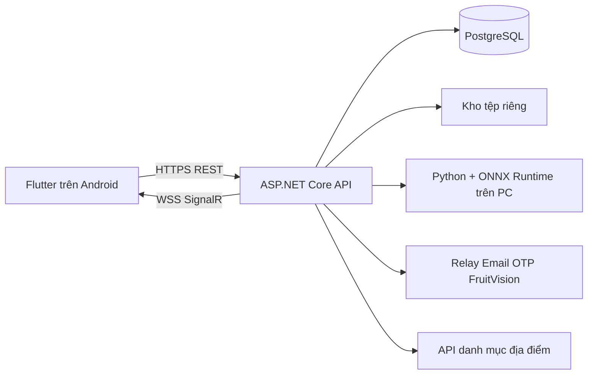
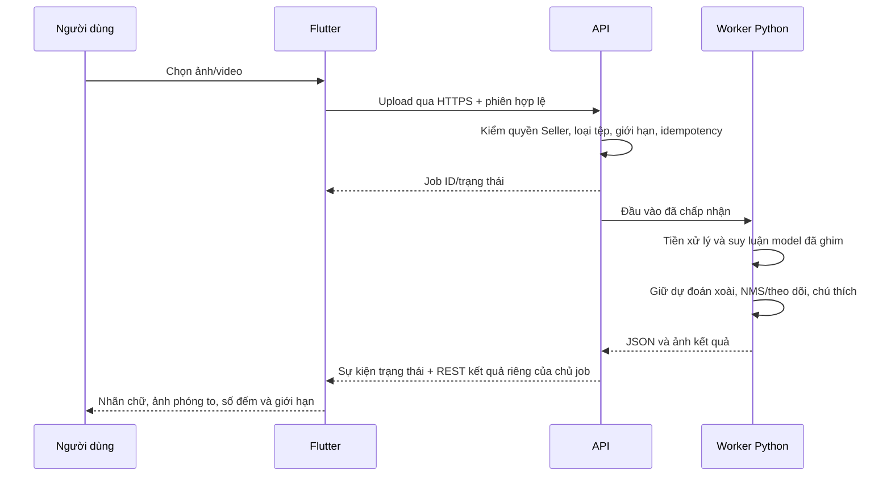

# FruitVision 2.4 — Báo cáo kỹ thuật triển khai

## 1. Mục đích và phạm vi

Đồ án Lập trình trên thiết bị di động gồm ứng dụng Flutter, API, CSDL và AI chạy trên máy tính. Trọng tâm là gửi ảnh/video, nhận diện xoài, xem dự đoán xanh/chín bằng chữ và ảnh chú thích, cùng cộng đồng chia sẻ kinh nghiệm. Không có giao dịch mua bán, thanh toán hoặc kết luận an toàn thực phẩm.

Bản 2.4.0+6010 sử dụng một địa chỉ máy chủ do người vận hành cấu hình. Điện thoại không chứa trọng số AI, không kết nối trực tiếp PostgreSQL, Google hoặc tiến trình Python. Xem [ma trận vai trò và thao tác](USER_WORKFLOWS_2_4.md).

## 2. Kiến trúc và ranh giới trách nhiệm

| Thành phần | Công nghệ đã dùng | Trách nhiệm |
|---|---|---|
| Giao diện di động | Flutter/Dart, Material, điều hướng theo vai trò | Nhập liệu, chọn/chụp tệp, hiển thị tiến độ/kết quả, bài viết, hội thoại |
| API | ASP.NET Core 10, OpenAPI, endpoint filters | Ràng buộc đầu vào, xác thực, phân quyền/ownership, hạn mức, điều phối công việc |
| Dữ liệu | EF Core, Npgsql, PostgreSQL | Tài khoản, hồ sơ xét duyệt, chi nhánh, bài viết, hội thoại, job và metadata tệp |
| Realtime | SignalR qua WSS, outbox cho tin thường | Phát thay đổi cho đúng người dùng; REST bù dữ liệu sau kết nối lại |
| AI | Python, ONNX Runtime CPU, Pillow/FFmpeg theo loại đầu vào | Tiền xử lý, suy luận, theo dõi hình học, tạo ảnh chú thích và JSON |
| Android | MethodChannel, Android Keystore, BiometricPrompt, trình chọn tệp hệ thống | Lưu phiên/khóa cục bộ, xác thực phần cứng nếu có, chọn tệp và mở trình cài cập nhật |
| Tin bí mật | sodium 4.1.2+1 / libsodium 1.0.22, crypto 3.0.7 | Mã hóa/ký trên client; máy chủ chỉ nhận bản mã và khóa công khai |
| Truy cập ngoài LAN | Cloudflare Tunnel HTTPS tạm | Chuyển tiếp tới API loopback trên PC, không mở PostgreSQL cho điện thoại |

PostgreSQL được dùng vì tài khoản, vai trò, xét duyệt và membership có quan hệ/ràng buộc cần giao dịch nhất quán. Nội dung chat có phân trang; tệp lớn không nhét vào hàng dữ liệu. Đây là lựa chọn theo cấu trúc dữ liệu, không phải tuyên bố NoSQL hoặc SQL luôn tốt hơn nhau.

## 3. Đăng ký, đăng nhập và phân quyền

1. App lấy quốc gia/tỉnh qua API FruitVision; backend mới gọi nguồn danh mục và cache có thời hạn.
2. Đăng ký công khai luôn tạo Consumer. Client không được tự chọn Admin/Producer/Trader.
3. Mật khẩu được xác minh qua ASP.NET Identity. Phản hồi yêu cầu Email OTP chưa tạo phiên đăng nhập.
4. OTP sáu chữ số, hạn 10 phút, tối đa năm lần sai, gửi lại có cooldown. Relay riêng dùng HMAC, nonce và khóa riêng phía server; APK không có khóa gửi thư.
5. Access token là chuỗi opaque, không phải JWT. Server giữ hash; access 15 phút, refresh tối đa bảy ngày và có xoay token/chống replay. Refresh không biến phiên cũ thành một lần xác thực mạnh mới.
6. Consumer đã xác minh gửi hồ sơ Producer hoặc Trader với minh chứng phù hợp; Admin xét duyệt. Chỉ duyệt thành công mới đổi vai trò.

Mỗi API kiểm quyền và đối tượng dữ liệu lại ở máy chủ. Admin không có quyền chạy AI hoặc đọc mặc nhiên mọi Direct. Consumer được học liệu và cộng đồng; AI dành cho hai vai trò Seller. `Seller` là chính sách chung, không phải vai trò thứ năm.

Sinh trắc học mạnh dùng khóa RSA trong Android Keystore và chữ ký thử thách; chỉ dựa vào kết quả phần cứng Android. Nhánh đối chiếu ảnh mặt 2D vẫn cần Email OTP, không có liveness. TOTP chỉ được giữ cho tài khoản đã tự bật trước đó; bản mới không hướng người đăng ký mới đi cài Authenticator.

## 4. Dữ liệu, bài viết và hội thoại

Các nhóm bảng chính gồm Identity/phiên, RoleApplication/minh chứng, SellerBranch, CommunityArticle, Conversation/Participant/Message, NormalImage, SecretDevice/Conversation/Message/Envelope/Attachment, AiJob và audit/outbox.

- Bài Consumer thuộc Community; bài Seller thuộc Professional và cần chi nhánh của mình đã được duyệt. Cả hai qua Admin xét duyệt; sửa/duyệt dùng revision để phát hiện xung đột.
- Liên hệ từ bài công bố tạo Direct đúng hai người. Advisory lock và unique index ngăn nhiều hội thoại khi bấm đồng thời; không nhận danh sách người tham gia tùy ý từ client.
- Tin/ảnh chat thường chỉ thành viên đọc được; máy chủ vẫn đọc và xử lý được nội dung này.
- Nhóm có membership, giới hạn thành viên, thao tác đóng/rời và quyền gửi riêng; rời nhóm không tiếp tục nhận sự kiện mới.

Ảnh thường được giới hạn kích thước, kiểm định dạng/giải mã, bỏ EXIF, chuẩn hóa JPEG cạnh tối đa 2048 trước lưu. Quota ảnh thường và blob bí mật dùng chung giao dịch: mặc định 100 MiB/tài khoản, 2 GiB toàn kho, chừa ít nhất 1 GiB ổ đĩa. Đầy quota trả lỗi rõ ràng, không tự xóa lịch sử. Không tuyên bố có dịch vụ quét virus.

## 5. Tin bí mật: mã hóa ở đúng đâu?

Client tạo cặp khóa X25519 và Ed25519 bằng libsodium. Nội dung được ký rồi đóng trong sealed envelope riêng cho mỗi thiết bị nhận; server không nhận private key hoặc nội dung rõ. Ảnh bí mật dùng secretbox; khóa/nonce và metadata kiểm tra ảnh nằm trong phần tin đã được mã hóa, không đặt vào URL công khai.

Khóa cục bộ được giữ trong key bag mã hóa AES-GCM bằng Android Keystore, ràng buộc với origin API và tài khoản. Hai bên phải so sánh toàn bộ mã an toàn 64 ký tự qua kênh tin cậy và pin khóa trước khi gửi; thay khóa làm client từ chối tiếp tục cho tới khi xác minh lại. Mỗi tài khoản có một thiết bị bí mật hoạt động. Đăng ký/thu hồi cần mật khẩu + OTP mới trong 15 phút.

Đây không phải giao thức Signal/Double Ratchet: chưa có forward secrecy, khôi phục khóa hoặc đồng bộ nhiều thiết bị. Kiểm thử giao thức và primitives không thay thế kiểm định mật mã độc lập. Máy chủ vẫn thấy metadata như người tham gia, thời gian, kích thước bản mã.

## 6. AI chạy trên PC, app gọi như thế nào?

**ONNX** là định dạng mô tả đồ thị và trọng số để runtime thực thi, không tự làm mô hình nhanh hoặc chính xác hơn. **ONNX Runtime** là bộ thực thi đồ thị. **FP32** nghĩa là số thực 32 bit dùng cho phép tính/trọng số của graph hiện tại; không phải tên kiến trúc. Bản này chạy graph FP32 trên PC, không chạy graph đó trong Flutter.

Graph hiện tại là YOLOX-Tiny, SHA-256 `8a69c66a9444c18c98a7e3e58a44f4dddda9eb4583dd4448f430ff9e8db27c41`, input 480×480. Worker giữ đối tượng dự đoán là xoài trước NMS/tracking. Giao diện có hai nhãn giai đoạn nguồn xanh/chín và Chưa xác định; không đổi tên grader năm lớp cũ thành model mới. [Bằng chứng mô hình và scope](mango-ai-scope-24.md).

Ảnh đơn dùng số đối tượng đang thấy, không giả lập track. Video dùng theo dõi hình học và qua vạch; che khuất, quay lại hoặc camera di chuyển có thể làm sai đếm. Hai nhãn nguồn chưa chứng minh độ chín cho mọi giống xoài; kết quả không xác nhận chất lượng bên trong, hư hỏng hoặc an toàn thực phẩm.

## 7. Tối ưu phần triển khai

| Biện pháp đang dùng | Tác dụng thực tế | Giới hạn |
|---|---|---|
| AI trên PC, job bất đồng bộ | Không chặn UI bằng suy luận; APK nhỏ, không mang model/Python | Phụ thuộc mạng, PC và hàng đợi; không gọi là offline |
| Streaming upload/download và cache tệp riêng | Tránh giữ toàn video/APK trong bộ nhớ Dart | Vẫn cần băng thông/dung lượng tạm |
| Xử lý ảnh Android ngoài UI thread | Lấy mẫu, sửa hướng và giảm kích thước trước gửi ảnh chia sẻ | Không tăng chất lượng dự đoán AI |
| Hạn mức, hàng đợi có giới hạn, timeout | Tránh nhận vô hạn công việc đắt đỏ | Quá tải phải trả 429/503, chưa có autoscaling |
| Phân trang/cursor, index, idempotency | Giảm dữ liệu và ghi lặp; giữ thao tác thử lại có kiểm soát | Không thay thế đo tải nhiều người dùng thực |
| WSS + debounce/dedup + REST catch-up | Cập nhật khi có thay đổi và phục hồi sau ngắt mạng | Không phải dịch vụ push nền Android |
| Cache danh mục địa điểm | Giảm gọi dịch vụ ngoài lặp lại | Có cờ stale/503, không tạo danh mục giả khi nguồn hỏng |

Trong lượt máy ảo API 30, app có PSS khoảng 96.8 MiB ở màn kết quả ảnh và RSS khoảng 209 MiB; RSS gồm các trang thư viện chia sẻ. Đây là ảnh chụp bộ nhớ theo thời điểm, không phải mức tối đa hoặc kết quả điện thoại thật. Không có bằng chứng 6/30 AI FPS cho phiên bản client–server này.

## 8. Bằng chứng và khả năng tái hiện

- Backend: 157 kiểm thử PostgreSQL/integration pass, không skip. Sau đổi tiêu đề relay, bốn kiểm tra Email OTP liên quan pass.
- Flutter: 110 kiểm thử nền pass; hai widget liên quan sau delta realtime pass; analyzer không còn lỗi trước thay một dòng văn bản cuối.
- HTTPS thật: 88 kiểm tra/49 request cho ảnh, bài, xét duyệt, article Direct, replay và ACL; dùng bốn phiên Email OTP, không phải bốn điện thoại.
- Tin bí mật: 40 quan sát real-Sodium/API, gồm envelope, ảnh, pin/signature/tamper và cleanup thiết bị do harness tạo. Không coi so sánh hai khóa trong harness là lễ so sánh ngoài băng của hai người.
- Android: bốn instrumentation test Keystore/scope/corruption/ảnh pass; APK release thử đăng nhập Email OTP, học liệu, ảnh AI/preview và tạo khóa Sodium trên máy ảo.
- Đóng gói: ba kiến trúc cùng version 6010/signer, SDK26–36, không AI weights, đúng ELF/native asset binding và nguyên văn giấy phép crypto. Bản ARM64 tải trọn qua HTTPS khớp SHA-256; cập nhật vẫn phải được người dùng xác nhận ở trình cài Android.

Các biên nhận công khai đi cùng gói phát hành. [Cài backend](../README.md), [build client](../../mobile_client/README.md), [luồng demo](USER_WORKFLOWS_2_4.md). Tài khoản, OTP, khóa, database dump và upload riêng không thuộc mã nguồn nộp.

## 9. Vận hành và hướng phát triển

PC phải chạy PostgreSQL, API, môi trường AI và tunnel. Cổng web có `index.html`, OpenAPI và link APK; app dùng cùng origin cho REST/WSS/media/update. URL tunnel tạm có thể đổi khi khởi động lại; tên miền cố định, backup vận hành, lưu trữ object, hàng đợi đa máy, push nền và kiểm thử điện thoại/nhiều người dùng là các việc tiếp theo.

Nguồn dữ liệu/model có hạn chế giấy phép; bản hiện tại phục vụ đồ án phi thương mại. Slide 23 trang được giữ nguyên là tư liệu đã trình bày trước đây, không tự đại diện cho toàn bộ kiến trúc 2.4 mới.
