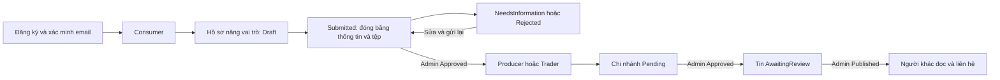

# FruitVision 2.3 — Vai trò, quy trình và giới hạn sử dụng

Tài liệu dành cho người chuẩn bị demo, phân tích nghiệp vụ và kiểm tra triển khai. Nội dung bám theo mã nguồn đang tích hợp ngày 30/10/2026. **Có mã nguồn và kiểm thử riêng không đồng nghĩa đã nghiệm thu bản APK 2.3 hoặc hệ thống HTTPS đang chạy.** Chỉ biên bản phát hành cuối cùng mới xác nhận đúng APK, máy chủ và các dịch vụ ngoài đã được kiểm tra cùng nhau.

## 1. Bốn vai trò và phạm vi thực tế

`Seller` là tên chính sách API dùng chung cho **Producer và Trader**, không phải vai trò thứ năm. Mỗi tài khoản có một vai trò hiện hành; nâng cấp không cộng dồn mọi quyền của các vai trò.

| Chức năng | Consumer — Người tiêu dùng | Producer — Nhà vườn | Trader — Thương lái | Admin — Quản trị |
|---|---|---|---|---|
| Đọc tin kinh doanh đã công bố, bài cộng đồng, giá/nguồn cung tham chiếu | Có | Có | Có | API công khai cho phép; luồng chính trong app là quản trị |
| Liên hệ từ tin để mở hội thoại riêng | Có, tài khoản được duyệt | Có, kể cả với Nhà vườn khác | Có | Không tạo liên hệ từ tin |
| Hội thoại đã tham gia; khám phá/tạo/tham gia nhóm | Có khi `Approved` | Có khi `Approved` | Có khi `Approved` | Có khi `Approved`; không tự được đọc mọi hội thoại |
| Gửi/sửa bài viết cộng đồng để kiểm duyệt | Có | Không theo vai trò hiện hành | Không theo vai trò hiện hành | Kiểm duyệt, không dùng quyền tác giả Consumer |
| Xin nâng vai trò Producer hoặc Trader | Có nếu đã xác minh email, đang hoạt động và `Approved` | Không | Không | Xét duyệt hồ sơ |
| Tạo/sửa chi nhánh kinh doanh của mình | Không | Có, chờ Admin duyệt | Có, chờ Admin duyệt | Xét duyệt chi nhánh |
| Gửi tin kinh doanh dự kiến | Không | Chỉ `Supply` — nguồn cung | `Supply` hoặc `Demand` — nhu cầu | Xét duyệt tin |
| AI ảnh/video, lịch sử tác vụ, thống kê và hướng dẫn AI của mình | Không | Có | Có | **Không có quyền thực thi/xem thống kê AI theo chính sách Seller** |
| Xét duyệt bài viết, tin kinh doanh, chi nhánh, hồ sơ nâng vai trò | Không | Không | Không | Có; cần phiên Admin đang hoạt động và được duyệt |
| Quản lý phiên đăng nhập, TOTP, khóa sinh trắc học của chính mình | Có, theo điều kiện xác thực | Có | Có | Có |

Tin/bài chưa công bố chỉ dành cho tác giả và Admin phù hợp. Admin không có quyền đọc tin nhắn hoặc kết quả AI riêng của người khác chỉ vì là Admin. Việc đọc tin nhắn vẫn cần tư cách thành viên hội thoại.

**Những gì chưa có:** đặt hàng, thanh toán, giao nhận, tồn kho xác thực, dự đoán giá thị trường, thiết bị IoT, thông báo đẩy nền và luồng camera nhận diện liên tục. Số lượng trong tin là **ước tính do người dùng khai**; API còn thể hiện `actualStockKg=null`, `canOrder=false`.

Nguồn: [chính sách API](../src/FruitVision.Api/Program.cs), [tin kinh doanh](../src/FruitVision.Api/Features/PostWorkflowEndpoints.cs), [bài viết/chi nhánh](../src/FruitVision.Api/Features/PublishingEndpoints.cs), [nhóm](../src/FruitVision.Api/Features/CommunityEndpoints.cs), [tab theo vai trò trong app](../../mobile_client/lib/client/ui/workspace.dart).

## 2. Luồng demo từ tài khoản mới đến giao tiếp kinh doanh

1. Người dùng chọn quốc gia và tỉnh/thành từ API, nhập thông tin đăng ký. Máy chủ tạo **Consumer**, không nhận trường tự chọn vai trò Admin/Producer/Trader.
2. Hoàn thành mã email. Tài khoản mới có `approvalStatus=Approved`, nhưng `emailConfirmed` chỉ thành `true` sau xác minh. Phản hồi yêu cầu nhập mã chưa phải phiên đăng nhập thành công.
3. Consumer có thể đọc nội dung, liên hệ, tham gia nhóm và gửi bài cộng đồng theo quyền. Muốn kinh doanh, tạo hồ sơ nâng vai trò, khai thông tin và tải minh chứng phù hợp.
4. Admin duyệt hồ sơ. Chỉ lúc kết quả là `Approved`, vai trò hiện hành mới chuyển sang Producer hoặc Trader. `NeedsInformation`/`Rejected` không cấp quyền kinh doanh và không biến tài khoản Consumer thành tài khoản bị khóa.
5. Seller tạo chi nhánh, chờ Admin duyệt. Tin kinh doanh mới phải chọn **chi nhánh thuộc mình đã được duyệt**; địa điểm tin do máy chủ lấy từ chi nhánh.
6. Seller gửi tin dự kiến. Admin công bố tin; người khác mở chi tiết và chọn liên hệ. Máy chủ tạo hoặc dùng lại hội thoại hai người. Hai bên gửi tin; người ngoài không đọc được dù biết ID.

Vai trò, trạng thái duyệt tài khoản, trạng thái hồ sơ nâng vai trò và trạng thái từng nội dung là các trường riêng. Sau khi được nâng vai trò, tải lại hồ sơ để app nhận quyền mới. API kiểm tra quyền trên mỗi yêu cầu; giao diện cũ không làm phát sinh quyền mới.

## 3. Hồ sơ nâng vai trò và minh chứng

Producer khai tên đơn vị/hộ, địa chỉ, quốc gia/tỉnh, điện thoại, danh mục sản phẩm và diện tích canh tác dương. Producer không dùng các trường đăng ký của Trader. Trader khai các thông tin chung và **ít nhất một** trong mã số thuế hoặc số đăng ký kinh doanh; không khai diện tích canh tác. Sản phẩm phải nằm trong danh mục API, không gửi tên tùy ý.

| Trạng thái hồ sơ | Người dùng được làm gì? | Kết quả xét duyệt |
|---|---|---|
| `Draft` | Sửa, thêm/xóa minh chứng, gửi xét duyệt | Chưa đổi vai trò |
| `Submitted` | Xem; thông tin và minh chứng đã đóng băng | Admin chọn `Approved`, `NeedsInformation` hoặc `Rejected` |
| `NeedsInformation` | Đọc lý do, sửa/bổ sung và gửi lại | Vẫn là Consumer |
| `Rejected` | Đọc lý do, sửa và gửi lại nếu không có hồ sơ đang hoạt động khác | Vẫn là Consumer |
| `Approved` | Xem hồ sơ đã duyệt; không sửa bằng luồng này | Đổi sang vai trò đã yêu cầu |

Mỗi người chỉ có một hồ sơ đang hoạt động trong `Draft`/`Submitted`/`NeedsInformation`. Tạo hoặc xét duyệt đồng thời không cấp hai vai trò. Mọi thao tác thay đổi tăng `revision`; phải gửi `expectedRevision` hiện tại. Nếu nhận **409**, tải lại và đọc trạng thái mới trước khi thao tác tiếp.

Minh chứng nhận JPEG, PNG hoặc PDF, **tối đa 5 MiB/tệp, 4 tệp/hồ sơ**. Producer cần ít nhất một `ProductionEvidence`; Trader cần ít nhất một `BusinessEvidence` trước khi gửi hoặc gửi lại. Không quy định bắt buộc giấy tờ định danh cá nhân; chỉ nộp nội dung cần thiết cho mục đích xét duyệt.

Tệp được kiểm tra loại khai báo/chữ ký định dạng, giới hạn khi đọc luồng và lưu bằng ID do máy chủ tạo ngoài thư mục công khai. Chỉ chủ hồ sơ hoặc Admin phù hợp tải được; PDF trả về dưới dạng tệp đính kèm. Không có URL công khai, không nhận đường dẫn hoặc URL nguồn do người dùng đưa vào. **Kiểm tra định dạng và SHA không phải quét virus hoặc xác minh tính thật của giấy tờ.** Không chia sẻ ảnh chụp chứa dữ liệu cá nhân trong nhóm để thay thế luồng minh chứng riêng.

Nguồn: [quy trình hồ sơ](../src/FruitVision.Api/Features/RoleApplicationEndpoints.cs), [hợp đồng dữ liệu](../src/FruitVision.Api/Contracts/RoleApplicationRequests.cs), [kho minh chứng](../src/FruitVision.Api/Infrastructure/RoleEvidenceStorage.cs).

## 4. Nội dung, chi nhánh, nhóm và giá tham chiếu

| Đối tượng | Trạng thái và quy tắc chính |
|---|---|
| Tin kinh doanh | `AwaitingReview → Published/Rejected`; `Published → Paused`; `Paused → Published`. Chỉ nội dung `Published` của tác giả hoạt động/được duyệt đi vào luồng công khai. |
| Bài cộng đồng của Consumer | Cùng bốn trạng thái trên. Tác giả sửa bài sẽ đưa về `AwaitingReview`; bài không tiếp tục công khai trong khi chờ duyệt lại. Tác giả có thể rút bài `Published` về `Paused`. |
| Chi nhánh Seller | Tạo/sửa đưa về `Pending`; Admin chọn `Approved`, `Rejected`, `NeedsInformation`. Chi nhánh `Approved` cũng có thể bị trả về; cần chỉnh sửa/gửi lại. Quyền đăng tin mới dựa trên chi nhánh hợp lệ tại thời điểm gửi. |
| Nhóm | Nhóm mở được khám phá, không có nghĩa mọi người đã được đọc tin nhắn. Phải tham gia mới đọc/gửi; tối đa 50 thành viên và 10 nhóm đang mở do một người sở hữu. Chủ nhóm/Admin có thể đóng; nhóm đóng không nhận thành viên/tin mới. Chủ nhóm phải đóng trước khi rời. |

Liên hệ từ tin chỉ dùng tin công khai và tác giả hợp lệ. Không tự liên hệ tin của mình; Admin không mở liên hệ từ tin. Consumer, Producer và Trader có thể liên hệ nhau, kể cả hai người cùng vai trò. Không gửi danh sách thành viên tùy ý: máy chủ tự xác định hai bên. Gửi lại yêu cầu hoặc hai yêu cầu đồng thời phải trả cùng hội thoại đã được tạo.

Chat lưu tin trước khi phát sự kiện. Tin có `sender:{id,displayName,role}` để phân biệt người nói, không kèm email. Khi mất WSS, quay lại app hoặc tải lại màn hình, dùng REST lấy trang tin gần nhất/tiếp tục lịch sử; không coi việc kết nối WSS thành công là bằng chứng đã nhận đủ mọi sự kiện. Người đã rời nhóm không tiếp tục nhận tin mới qua nhóm kết nối cũ. Không có thông báo đẩy khi ứng dụng đã đóng.

Giá tham chiếu lấy từ các khoảng **giá chào bán Supply đã công bố**, tính trung vị điểm giữa khoảng giá; không đưa giá hỏi mua Demand vào mẫu giá. Có nguồn, thời điểm và số mẫu; không có mẫu hợp lệ thì để trống. Đây không phải giá giao dịch chính thức hoặc dự đoán AI. Cộng lượng cung/cầu có thể trùng cùng một lô do người dùng đăng nhiều tin; không đổi nhãn thành tồn kho thực.

Nguồn: [đăng và duyệt nội dung](../src/FruitVision.Api/Features/PublishingEndpoints.cs), [liên hệ](../src/FruitVision.Api/Features/PostWorkflowEndpoints.cs), [outbox và quyền nhận tin](../src/FruitVision.Api/Realtime/FruitHub.cs), [phục hồi chat](../../mobile_client/lib/client/ui/chat.dart), [giá tham chiếu](../src/FruitVision.Api/Features/MarketEndpoints.cs).

## 5. Địa điểm phải chọn từ API

App lấy quốc gia ở `/api/v1/locations/countries`, tỉnh/thành ở `/api/v1/locations/provinces?country=...`. Hồ sơ mới gửi `countryCode`/`provinceCode`; máy chủ tự tạo nhãn `region` đã kiểm tra, không tin nhãn tự nhập.

Nguồn cấu hình trong mã gồm REST Countries, dự phòng CountriesNow, nhãn lãnh thổ tiếng Việt Unicode CLDR và **nguồn Việt Nam `provinces.open-api.vn/api/v2/` với 34 đơn vị**. Không lấy danh sách 63 tỉnh cũ làm dự phòng cho Việt Nam. Mã quốc gia là ISO hai chữ cái; với nguồn quốc tế thiếu mã tỉnh, API có thể cấp mã tham chiếu nội bộ có nhãn `codeKind`, không được gọi mã đó là mã hành chính chính thức.

Cache mới có hiệu lực 24 giờ. Khi nguồn lỗi, chỉ dùng ảnh chụp dữ liệu đã xác minh còn hạn tối đa 7 ngày; `stale` và `asOf` phản ánh tình trạng đó. `asOf` là thời điểm lấy dữ liệu, **không phải ngày hiệu lực pháp lý của địa giới**. Không có cache còn hạn thì trả **503**, không tạo địa điểm giả.

Đổi quốc gia phải xóa tỉnh đã chọn, xóa danh sách cũ và bỏ qua phản hồi mạng đến muộn của quốc gia trước. Danh mục trống/lỗi thì ngừng gửi biểu mẫu, cho tải lại; không tự điền một tỉnh mặc định hoặc thêm ô văn bản để bỏ qua kiểm tra.

Dữ liệu cũ có thể còn `region` dạng chữ và chưa có mã quốc gia/tỉnh; tin cũ có thể mang `LegacyUnrecorded` về chi nhánh. Đây là dữ liệu lịch sử/tổng hợp để demo, không tự suy diễn thành mã địa giới mới hoặc chứng nhận chi nhánh. Tạo/sửa hồ sơ và chi nhánh mới phải chọn danh mục hiện tại.

Nguồn: [thư mục và nguồn dữ liệu](../src/FruitVision.Api/Infrastructure/LocationDirectory.cs), [API địa điểm](../src/FruitVision.Api/Features/LocationEndpoints.cs), [bộ chọn trong app](../../mobile_client/lib/client/ui/location_picker.dart).

## 6. Đăng nhập, email, TOTP và sinh trắc học

**Email OTP:** đăng ký cần xác minh email; đăng nhập bằng mật khẩu dùng email OTP theo cấu hình vận hành, trừ nhánh TOTP đã bật. Mã có 6 chữ số, hạn 10 phút, tối đa 5 lần nhập sai; gửi lại có thời gian chờ 60 giây và không xóa số lần sai. Chưa gửi được mã thì trả 503 và không cấp phiên. Mã cũ không tiếp tục dùng sau khi được thay bằng mã mới hoặc đã dùng thành công.

Hệ thống demo dùng bộ chuyển tiếp thư dùng chung. Tiêu đề hiện tại là **“Mã xác thực Chấm công”**, được API/app công bố; không trình bày như một hạ tầng thư FruitVision độc lập. Một số tài khoản tổng hợp có thể được người vận hành ánh xạ đến hộp thư demo. Không đưa địa chỉ thực, mã OTP, bí mật relay hoặc nội dung thư vào tài liệu/chụp màn hình công khai. Cần thử nhận thư thực tế trước buổi demo; kiểm thử giả lập transport không thay cho bước này.

**TOTP:** người dùng chủ động thiết lập ứng dụng xác thực bằng mật khẩu, xác nhận mã rồi bật. Đăng nhập nhánh này dùng mã ứng dụng xác thực. Khóa thiết lập/mã QR là bí mật, không đưa vào slide. Bật TOTP thu hồi các phiên để đăng nhập lại; ảnh khuôn mặt không được dùng để bỏ qua nhánh TOTP.

**Sinh trắc học mạnh trên Android:** đây là lựa chọn bổ sung trên thiết bị/API được hỗ trợ, native hiện yêu cầu **API 28 trở lên**, phần cứng phù hợp và sinh trắc học đã đăng ký. Android 26/27 vẫn dùng luồng tài khoản thông thường. Không có nhánh dùng PIN thiết bị thay cho sinh trắc học trong luồng này.

Khóa RSA nằm trong Android Keystore; BiometricPrompt mở quyền ký cho từng thao tác. Máy chủ giữ khóa công khai, phát chuỗi thử thách một lần có hạn 2 phút và kiểm tra chữ ký SHA-256/RSA PKCS#1 v1.5. Không chấp nhận `biometricVerified=true`. Đăng ký/đổi khóa cần phiên mật khẩu + email OTP hoặc TOTP mới trong 15 phút; đăng nhập sinh trắc học đơn thuần không đủ để thêm khóa. Mỗi tài khoản tối đa 10 thiết bị đang hiệu lực. Xóa/đổi khóa làm vô hiệu thử thách cũ và phiên đã cấp qua khóa đó. Khóa native được phân theo địa chỉ máy chủ và tài khoản: đổi URL có thể cần đăng ký lại khóa và thu hồi mục cũ không dùng. Đây là kiểm tra quyền sở hữu khóa được app bảo vệ bằng sinh trắc học; không tuyên bố máy chủ đã chứng thực phần cứng từ xa.

**Ảnh khuôn mặt 2D + email OTP:** nhánh này đang tích hợp, chỉ được phép dùng khi readiness thật xác nhận sẵn sàng. Mã nguồn đã có API trạng thái, đăng ký, đối chiếu và xóa mẫu; `faceReady` còn phụ thuộc bộ xử lý và email OTP thực tế. Nút/UI hoặc route có sẵn chưa chứng minh tính năng đã chạy trên bản phát hành. Nhánh riêng này nhận JPEG/PNG tối đa 2 MiB dưới dạng base64 giới hạn, đối chiếu ảnh 2D rồi tiếp tục email OTP, không cấp token chỉ dựa vào ảnh. Mẫu embedding được bảo vệ bằng ASP.NET Data Protection theo người dùng; đó vẫn là dữ liệu nhạy cảm. Không có kiểm tra người thật/liveness, không gọi đó là Face ID hay nhận diện khuôn mặt phần cứng của điện thoại. Cần nghiệm thu riêng việc đăng ký, bảo quản khóa bảo vệ/xóa mẫu và bản sao ảnh tạm, ảnh sai và từ chối khi dịch vụ không sẵn sàng trước khi bật.

Nguồn: [mật khẩu/TOTP/phiên](../src/FruitVision.Api/Auth/AuthEndpoints.cs), [OTP và giới hạn](../src/FruitVision.Api/Auth/EmailOtpService.cs), [transport thư](../src/FruitVision.Api/Auth/AppsScriptOtpMailer.cs), [khóa thiết bị](../src/FruitVision.Api/Auth/DeviceBiometricEndpoints.cs), [Keystore/BiometricPrompt native](../../mobile_client/android/app/src/main/kotlin/vn/mangodemo/mango_offline/DeviceBiometrics.kt), [readiness phương thức](../src/FruitVision.Api/Auth/EmailOtpEndpoints.cs), [nhánh mặt đang tích hợp](../src/FruitVision.Api/Auth/FaceAuthEndpoints.cs), [thông báo UI ảnh 2D](../../mobile_client/lib/client/ui/face_photo.dart).

## 7. AI của Seller: hiểu đúng kết quả

Ảnh JPEG/PNG tối đa **12 MiB**; video MP4 tối đa **80 MiB, 120 giây, 1920×1080**. Máy chủ xử lý một tác vụ, hàng chờ toàn cục 4 tác vụ và mỗi người một tác vụ đang chờ/chạy; đầy hàng chờ trả 429. Có hủy, timeout xử lý 180 giây, tiến độ WSS và REST để khôi phục. Tệp gửi theo luồng nhị phân; mô hình chạy trên PC, không chạy AI ngoại tuyến trong APK Flutter này.

Thống kê `/ai/stats?days=7|30|90` chỉ tổng hợp tác vụ của chính Seller, theo ngày UTC: thành công, lỗi, đang chờ/chạy, đã hủy, loại ảnh/video và số khung đã xử lý. Không suy ra độ chính xác, khối lượng hoặc số quả vật lý duy nhất. `maxVisibleCount`, `confirmedTrackCount`, `lineCrossingCount` có ý nghĩa khác nhau; kết quả giai đoạn màu/chín có thể sai hoặc chưa xác định, không xác nhận an toàn thực phẩm. Số đo thông lượng PC không phải FPS trên điện thoại.

Nguồn: [API AI](../src/FruitVision.Api/Ai/AiEndpoints.cs), [thống kê/hướng dẫn](../src/FruitVision.Api/Ai/AiInsightsEndpoints.cs), [worker](../ai/worker.py).

## 8. Danh sách kiểm tra trước demo/triển khai

| Kiểm tra bằng tình huống thật | Kết quả cần quan sát |
|---|---|
| Đúng máy chủ, đúng APK và cấu hình | Health/readiness, các phương thức đăng nhập và trang API khớp bản triển khai; chưa dùng UI mới với API cũ rồi kết luận chức năng lỗi. |
| Đầu vào sai/thuộc tính lạ | Lỗi có nghĩa; không cấp quyền từ trường `role`, boolean xác thực hoặc ID người khác. Giới hạn cũng được thực thi tại API, không chỉ ở nút bị ẩn. |
| IDOR với tài khoản thứ ba | Không xem/sửa hồ sơ, minh chứng, tin nhắn hoặc tác vụ AI riêng của người khác; biết GUID không tạo quyền. |
| Hai người thao tác cùng phiên bản | Một thay đổi thắng; thao tác stale nhận 409, tải lại để quyết định; không lặp mù thao tác duyệt/gửi. |
| OTP/thử thách hết hạn hoặc đã dùng | Không phát token; mã gửi lại không khôi phục số lần đoán; dùng phương thức hỗ trợ khác khi cần, không bỏ qua xác thực. |
| Email/địa điểm/AI trả 503 | Hiển thị dịch vụ chưa sẵn sàng; không giả báo đăng nhập/địa điểm/kết quả AI thành công. |
| Danh mục trống, đổi quốc gia nhanh, mạng chậm | Tỉnh cũ bị xóa, phản hồi cũ bị bỏ qua, không gửi mã không thuộc quốc gia hiện tại. |
| Đổi vai trò/khóa tài khoản | Quyền API đổi ngay, không phụ thuộc UI; tải lại profile và kết nối realtime. Dữ liệu nghiệp vụ/lịch sử vẫn được giữ. |
| Hai đến bốn tài khoản chat; tắt/bật mạng | Kiểm tra cả dữ liệu REST đã lưu và WSS; người mới/rời nhóm được xử lý theo thành viên hiện tại; xem đúng tên/vai trò người gửi. |
| Tệp riêng và ảnh chụp demo | Tệp không có URL công khai, PDF là attachment; che dữ liệu cá nhân. Không tuyên bố đã có AV scan. Xóa bản sao tạm theo luồng app, không xóa dữ liệu máy chủ bằng thao tác tùy tiện. |
| Mất mạng hoặc tắt app | Không có AI offline, camera AI liên tục hoặc push nền. Dùng lịch sử REST khi kết nối lại; không coi màn hình cũ là trạng thái máy chủ mới nhất. |
| HTTPS trên PC thay đổi địa chỉ | Lấy URL hiện hành từ người vận hành, cập nhật cấu hình app và đăng nhập lại; không ghi token/mật khẩu vào URL, tài liệu hay APK. Chuẩn bị PC, PostgreSQL, bộ xử lý và tunnel còn chạy. |
| Sinh trắc học và cập nhật APK | Thử trên thiết bị thực sự hỗ trợ; quyền cài APK vẫn cần Android xác nhận. Không hứa cài âm thầm hoặc coi kiểm thử chữ ký phần mềm là đã thử vân tay thật. |

## 9. Bằng chứng và trạng thái nghiệm thu

Đã có các đợt kiểm thử riêng dùng HTTP và **PostgreSQL thật**: nhóm hồ sơ vai trò + thống kê AI đạt **15/15**, nhóm giao thức khóa thiết bị đạt **7/7**. Địa điểm có kiểm thử provider giả lập, cache và lỗi nguồn; thư OTP có kiểm thử luồng/transport. Đây là bằng chứng từng phạm vi, **không cộng các số để tuyên bố một full suite cuối cùng**. Các thay đổi tích hợp mới nhất cần biên bản full suite của người phát hành.

Kiểm thử RSA tạo khóa trong bộ nhớ để xác minh giao thức thật; nó không xác minh cảm biến vân tay hoặc Android Keystore trên điện thoại. Kiểm thử mail/địa điểm giả lập không chứng minh dịch vụ ngoài đang hoạt động. Kết quả live/APK 2.2 trước đó không thay cho nghiệm thu các luồng 2.3 mới. Tại thời điểm tài liệu này, chưa xác nhận triển khai live và APK 2.3 cuối cùng, chưa xác nhận nhánh mặt 2D sẵn sàng.

Tham chiếu các bộ kiểm thử: [vai trò/minh chứng](../tests/FruitVision.Tests/RoleApplicationTests.cs), [AI insights](../tests/FruitVision.Tests/AiInsightsTests.cs), [khóa thiết bị](../tests/FruitVision.Tests/DeviceBiometricTests.cs), [địa điểm](../tests/FruitVision.Tests/LocationDirectoryTests.cs). Tài khoản và dữ liệu mẫu là dữ liệu tổng hợp phục vụ demo, không phải bằng chứng về hộ kinh doanh, lượng hàng hay giao dịch thực tế.
